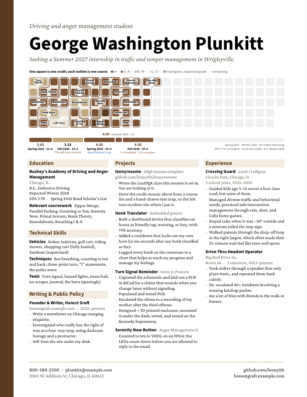
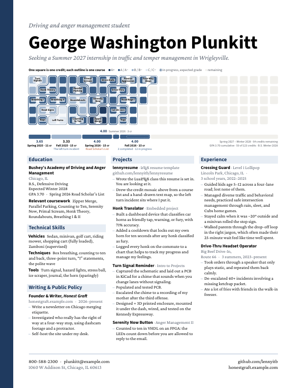
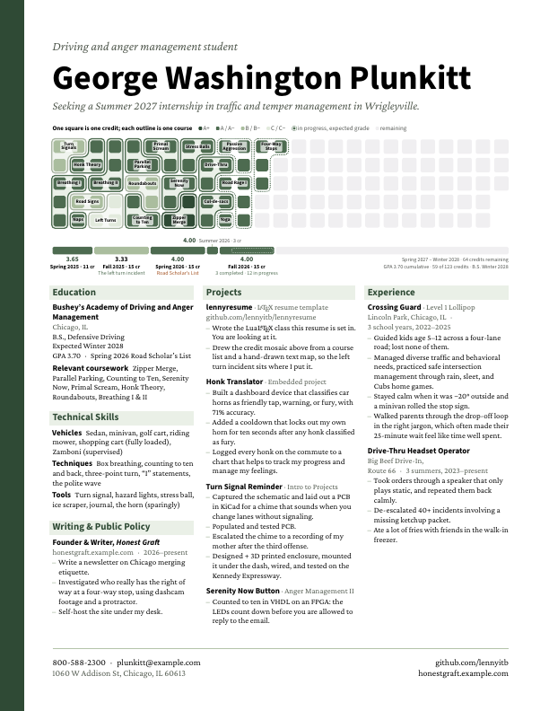
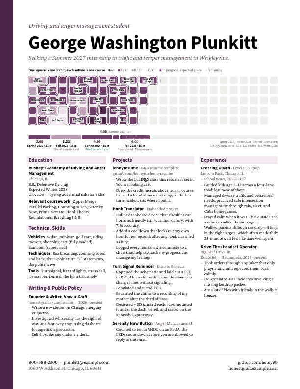
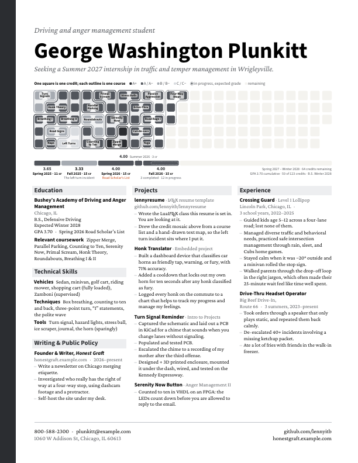

# Credit mosaic resume

A one-page LaTeX resume for students, built around a chart of your degree: one
square per credit, each course an outlined shape of its credits, shaded by
grade, with a bar underneath splitting the same credits by term. Recruiters
see at a glance how far along you are and how you've done.



## Building it

The class needs **LuaLaTeX** (the mosaic is drawn by a Lua script during the
build).

- **On your computer:** with TeX Live or MacTeX installed, run
  `latexmk resume.tex`. The included `.latexmkrc` selects LuaLaTeX.
- **On Overleaf:** upload every file, then set *Menu → Compiler* to
  **LuaLaTeX**.

| File | What it is |
| --- | --- |
| `resume.tex` | Your resume text. Edit this. |
| `courses.lua` | Your courses, their layout on the grid, and the term bar. Edit this. |
| `mosaicresume.cls` | Page layout, fonts and the commands `resume.tex` uses |
| `mosaicresume-palettes.tex` | The color palettes |
| `creditmosaic.lua` | Draws the mosaic |

## Color palettes

| walnut | harbor | forest | plum | graphite |
| --- | --- | --- | --- | --- |
|  |  |  |  |  |

Pick one on the first line of `resume.tex`:

```latex
\documentclass[palette=forest]{mosaicresume}
```

Change single colors on top of a palette in the preamble, or define your own
palette from an existing one:

```latex
\usepalette{forest, highlight=1C5CAB}
\definepalette{mine}{harbor, bar=12355B, gradeAp=12355B}
\usepalette{mine}
```

Every color key is listed at the top of `mosaicresume-palettes.tex`.

## Your courses

Each course in `courses.lua` is one line: an id, the label printed on it, its
credits, and the grade.

```lua
courses = {
  { "B1", "Breathing I",     4, "A" },
  { "LT", "Left Turns",      3, "C+" },
  { "ZM", "Zipper\nMerge",   3, "A+" },
  { "RR", "Road Rage I",     4, "A", current = true },  -- in progress: dotted outline
},
```

A+ is the darkest shade, then A and A−, then the B grades, then C and
anything lower. `"\n"` breaks a label onto two lines, which narrow
courses need.

## Arranging the courses

Nothing is packed for you unless you ask. The arrangement is yours, so you
can keep courses roughly in the order you took them, group a subject
together, or tuck a weaker grade into a corner. You draw it as a map: the
grid as it will print, top row first, with a course's id in each of its
squares.

```lua
layout = [[
  TS TS HT B2 PP PS PS SB SB PA PA FW FW
  TS HT HT B2 PP PP PS SB DT DT PA FW
  B1 B1 B2 B2 RB RB SN SN DT RR RR FW
  B1 RS RS LT CT RB SN ZM CD CD RR
  B1 NP LT LT CT CT ZM ZM CD YG RR
]],
```

- Write a course's id once for each credit, in squares that touch side to side.
- `.` leaves a square empty. Rows can be different lengths.
- The grid fills column by column. With `rows = 5` and `total = 123`, the
  last column has 3 squares.
- A course name sits on the first side-by-side pair in its top row. If a
  course has no pair, the name goes on its top-left square.

You don't have to draw the map from scratch. Leave `layout` out, or leave
some courses off the map, and those courses are placed automatically in the
free squares. Either way, every build writes the full map to `resume.log`:

```
Credit mosaic layout (paste into layout = [[ ... ]] to arrange by hand):
    TS TS HT LT LT PP PP SB SB PA PA FW FW
    TS HT HT B2 LT RB PP SB DT DT PA FW .
    ...
```

So start with your course list, build once, paste the map from the log into
`courses.lua`, and rearrange from there. If a map is wrong, the build stops
with a message such as *TS has 3 credits but 4 squares in the layout map*.

## The term bar

```lua
terms = {
  { "Fall 2025 · 15 cr",   credits = 15, gpa = "3.40", grade = "B" },
  { "Spring 2026 · 15 cr", credits = 15, gpa = "4.00", grade = "A",
    note = "Dean's List", honor = true },
  { "Fall 2026 · 16 cr",   credits = 16, gpa = "4.00", grade = "A", current = true },
},
remaining = "Spring 2027 – Spring 2028 · {remaining} credits remaining",
summary   = "GPA 3.80 cumulative · {credits} of {total} credits · B.S. Spring 2028",
```

`grade` shades a term's bar like a course square. A term narrower than about
40 pt gets its label above the bar. `current = true` puts a dotted box over
the credits still in progress. `{credits}`, `{total}`, `{remaining}` and
`{inprogress}` are filled in from your course list. Leave `terms` out to drop
the bar.

## The rest of the page

`resume.tex` uses a few commands from the class:

- `\nameblock{kicker}{Name}{objective}`
- `\mosaiclegend{title}` then `\creditmosaic` for the chart
- `threecolumns`, with `\nextcolumn` between columns. The middle column is
  `\middlecolumn` wide (2.3 in); the outer two share the rest.
- `\rsection{Heading}`, `\entry{Title}[subtitle]`, `\meta{place · dates}`,
  `\skill{Label}{list}`, the `rbullets` list, `\gapafter` between entries
  and `\sectiongap` between sections
- `\contactfooter{left lines}{right lines}`, with `\muted{...}` for gray text

Paper is US letter; `\documentclass[a4]{mosaicresume}` switches to A4.

The text font is Crimson Pro and the headings are Source Sans 3; both come
with TeX Live and Overleaf. To use other fonts, set them in the preamble:

```latex
\setmainfont{Minion Pro}
\setsansfont{Myriad Pro}
```

After changing palettes or the resume text, `docs/make-previews.sh`
re-renders the preview images.

## License, and a small favor

MIT; see [LICENSE](LICENSE). Use it for anything.

One request, as a favor: please don't use this template
to apply for engineering internships in the Philadelphia metro for the time
being. I'm still competing for those.
